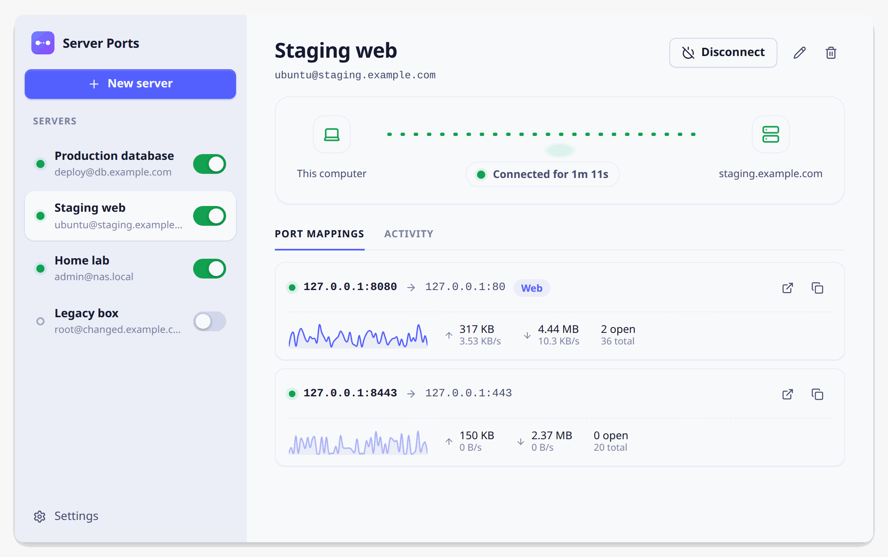
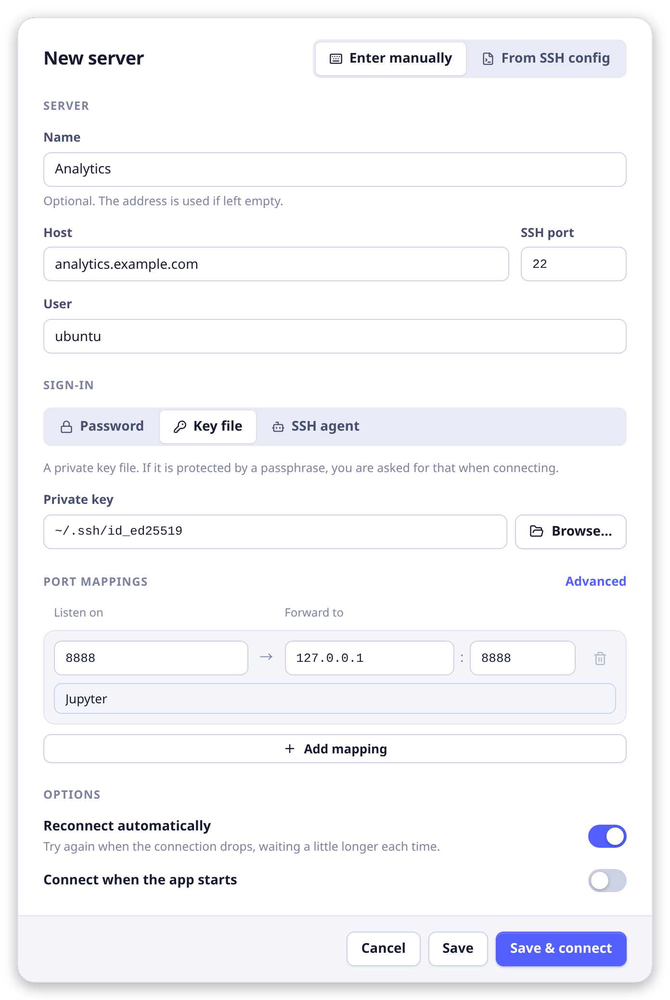
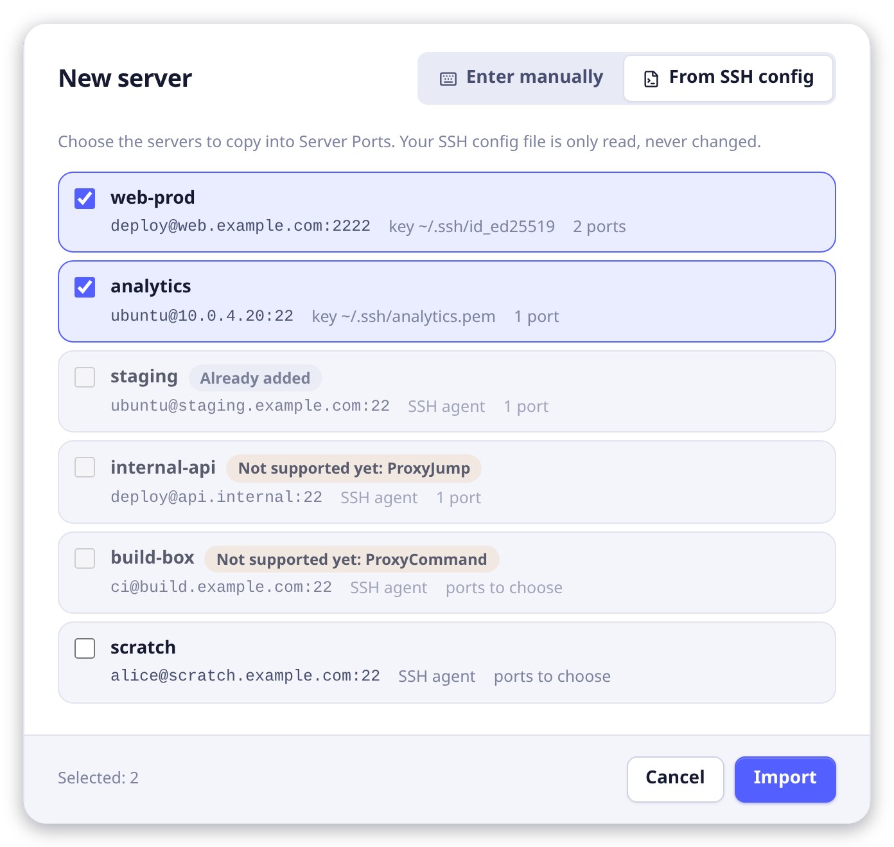
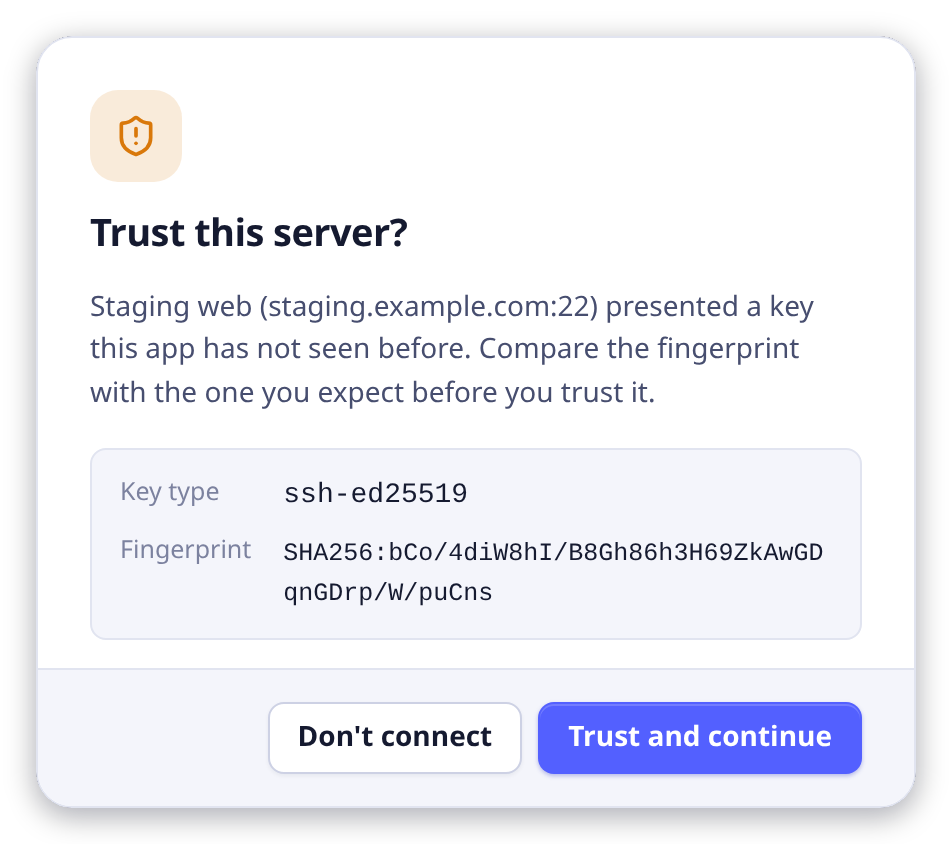
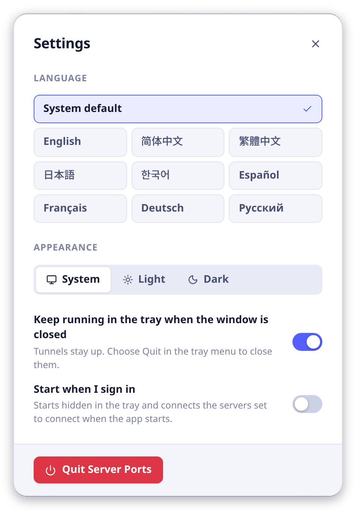

<div align="center">

# Server Ports

**Map remote server ports to your local machine over SSH.**

English | [简体中文](docs/README.zh-CN.md) | [繁體中文](docs/README.zh-TW.md) | [日本語](docs/README.ja.md) | [한국어](docs/README.ko.md) | [Español](docs/README.es.md) | [Français](docs/README.fr.md) | [Deutsch](docs/README.de.md) | [Русский](docs/README.ru.md)

</div>

> **Status: early development.** The first release is v0.1.0. The tunnel engine and the interface are in place, and CI builds, tests and packages the app on Linux, macOS and Windows, but only the Linux `.deb` has been installed and tried so far (on Ubuntu): the other installers are untested, and none of them is code-signed.

Server Ports is a small cross-platform desktop app (Windows, macOS, Linux) that keeps your SSH port forwards running. Pick a server, list the ports you need, and they appear on `localhost`. It is the same thing as `ssh -L`, minus the terminal juggling.

<p align="center">
  <picture>
    <source media="(prefers-color-scheme: dark)" srcset="docs/images/overview-dark.png">
    
  </picture>
</p>

## Features

- **Server profiles**: one profile per SSH server, with as many port mappings as you need.
- **Import from your SSH config**: pick servers from `~/.ssh/config` and copy them into Server Ports in one go, in the New server dialog or from the start screen. Host name, user, port, key file (`IdentityFile`) and port forwards (`LocalForward`) come along, including settings inherited from `Host *` blocks and `Include`d files. It is a one-time copy: your SSH config is only read, never changed.
- **Three ways to sign in**: password, private key file (with an optional passphrase), or ssh-agent (OpenSSH agent or Pageant).
- **Secrets stay out of the config file**: if you ask for it, passwords and key passphrases are kept in the macOS Keychain, Windows Credential Manager or the Linux Secret Service; otherwise they are only held in memory while a server is connected.
- **Host key verification**: a server key you have not seen before is shown with its fingerprint and trusted only if you say so; a key that has changed is flagged.
- **Private by default**: forwards listen on `127.0.0.1`, so only your own machine can reach them.
- **Auto-reconnect**: dropped connections are retried with a growing delay (from 1 s up to 30 s), and a profile can connect as soon as the app starts.
- **Live status**: connection state per server, listening state per mapping, open connections, traffic counters and a small throughput graph.
- **Lives in the tray**: closing the window hides the app in the system tray instead of quitting (this can be turned off), and the tray menu switches each server on or off. The app can also start when you sign in.
- **Light and dark theme**, with an interface in nine languages: English, Simplified and Traditional Chinese, Japanese, Korean, Spanish, French, German and Russian. It follows the system language until you pick one.
- **Small footprint**: built with Tauri 2, a Rust core and the system web view, with no bundled browser.

## Install

Download the installer for your system from the [Releases page](https://github.com/gchensy/server-ports/releases) and run it:

- **Windows**: the `.exe` installer, or the `.msi`. The installers are not code-signed yet, so Windows SmartScreen warns you on the first run: choose More info, then Run anyway.
- **macOS**: the `.dmg` (`aarch64` for Apple silicon, `x64` for Intel). Drag Server Ports into Applications. The app is only signed ad hoc, so open it the first time with a right-click and Open, or allow it in System Settings, Privacy & Security.
- **Linux**: the `.deb` (Debian, Ubuntu), the `.rpm` (Fedora, openSUSE) or the `.AppImage`. For example:

```bash
sudo apt install ./Server*.deb     # Debian, Ubuntu
sudo dnf install ./Server*.rpm     # Fedora
chmod +x Server*.AppImage && ./Server*.AppImage
```

On GNOME the tray icon needs the AppIndicator extension (see Known limitations below). The app does not update itself: to upgrade, install the newer version over the old one.

## Getting started

### 1. Add a server

Click **New server** and fill in the form:

- **Server**: the host (a name or an IP address), the SSH port, the user, and a name for the list if you like.
- **Sign-in**: a **Password**, a private **Key file** (**Browse…** picks it) or the **SSH agent**.
- **Port mappings**: type the port you want on your own computer in **Listen on**; the port to forward to on the server (**Forward to**) follows it, and you can change it. Add a mapping for every port you need, with a label if you like. **Advanced** shows the **Local address** a port listens on: `127.0.0.1` keeps it to your own computer.
- **Options**: **Reconnect automatically** when the connection drops, and **Connect when the app starts**.

<p align="center">
  
</p>

**Save & connect** saves the server and connects at once; **Save** only saves it. Later, the pencil and bin buttons at the top right of a server edit and delete it.

Do you have your servers in `~/.ssh/config` already? Switch the dialog to **From SSH config**, tick the servers you want and click **Import**. The host, user, port, key file and `LocalForward` ports come along; your SSH config is only read, never changed.

<p align="center">
  
</p>

### 2. Connect

Switch the server on in the list, or open it and click **Connect**. The first time you connect to a server, Server Ports shows the key type and the fingerprint it presented and asks whether to trust it. Compare the fingerprint with the one you expect (on the server, `ssh-keygen -lf /etc/ssh/ssh_host_ed25519_key.pub` prints it), then click **Trust and continue**, or **Don't connect** if it is not the one you expect. The key is remembered from then on, and if it ever changes, the connection is stopped and you are told.

<p align="center">
  
</p>

If the server signs you in with a password, or with a key that has a passphrase, you are asked for it next. Tick **Remember in the system keychain** to keep it in your system's credential store; otherwise it is only held in memory while the server is connected.

### 3. Use the ports

Once the server is connected, its port mappings show a green dot and the ports are open on your computer: browse to `http://127.0.0.1:8080`, or point any tool at the local port, such as a database client at `127.0.0.1:5432`.

- The two buttons at the right of a mapping open its address in your browser and copy it.
- Under the address you see a small throughput graph, the data sent and received, and how many connections are open now and in total.
- The **Activity** tab shows what happened on this server (connecting, reconnecting, errors): look there first if something does not work.
- If the connection drops, Server Ports reconnects by itself (unless you turned that off for the server), waiting a little longer each time, up to 30 s. **Retry now** skips the wait.

### 4. Leave it running

Close the window and the tunnels keep running in the system tray. Click the tray icon, or choose **Show Server Ports** in its menu, to bring the window back; starting the app a second time does the same. The tray menu also switches each server on or off, connects or disconnects all of them, and has **Quit**.

Open **Settings**, at the bottom left of the window, to choose the language and the appearance, to start the app when you sign in, or to quit the app along with its window instead of keeping it in the tray. **Quit Server Ports** closes the app and all its tunnels.

<p align="center">
  
</p>

## How it works

Every mapping forwards a port on your machine to an address that the SSH server can reach:

```text
127.0.0.1:8080 (your machine)  ──encrypted SSH──►  127.0.0.1:80 (the server)
```

That is the same as `ssh -L 127.0.0.1:8080:127.0.0.1:80 user@server`. The target is resolved on the server, so `127.0.0.1` means the server itself, and any other host the server can reach works too.

## Known limitations

- No keyboard-interactive (two-factor) login, jump hosts (`ProxyJump`) or host certificates yet.
- Only local forwards (`ssh -L`); remote (`-R`) and SOCKS (`-D`) forwards are not supported.
- Importing from `~/.ssh/config` is a one-time copy; later edits to the file are not picked up. Hosts that need `ProxyJump` or `ProxyCommand` are listed but cannot be imported yet, `Match` blocks are skipped, and `RemoteForward` and `DynamicForward` lines are ignored. A host without a `LocalForward` opens the form so you can choose its ports.
- On GNOME the tray icon needs the AppIndicator extension. Without it, turn off "Keep running in the tray when the window is closed" in Settings, or start the app again to bring its window back.

## Development

Prerequisites:

- Node.js (current LTS) and npm
- Rust 1.90 or newer ([rustup](https://rustup.rs))
- Tauri's system dependencies for your OS, see the [Tauri prerequisites](https://tauri.app/start/prerequisites/). On Debian/Ubuntu:

```bash
sudo apt update
sudo apt install libwebkit2gtk-4.1-dev build-essential curl wget file libxdo-dev libssl-dev libayatana-appindicator3-dev librsvg2-dev
```

Then:

```bash
npm install
npm run tauri dev    # run the app with hot reload
npm run dev          # the interface alone in a browser, with a fake backend instead of SSH
npm run tauri build  # build installers into src-tauri/target/release/bundle/
npm run typecheck    # type-check the frontend
cargo test --manifest-path src-tauri/Cargo.toml  # run the Rust tests
```

## Installers and releases

GitHub Actions does the packaging, so no machine of yours has to build for macOS or Windows.

- **CI** (`.github/workflows/ci.yml`) runs on every pull request and on `main`: it type-checks and builds the interface, and runs rustfmt, clippy and the Rust tests on Linux, macOS and Windows.
- **Release** (`.github/workflows/release.yml`) builds the installers: `.deb`, `.rpm` and `.AppImage` for Linux, `.dmg` for macOS (Apple silicon and Intel), `.exe` and `.msi` for Windows.

To release a version, set the same version number in `package.json`, `src-tauri/tauri.conf.json` and `src-tauri/Cargo.toml`, commit, then tag and push:

```bash
git tag v0.2.0
git push origin v0.2.0
```

The workflow refuses a tag that does not match those three versions. It attaches the installers to a draft release, which you review and publish on GitHub. Running **Release** by hand (Actions tab, Release, Run workflow) builds the same installers as downloadable workflow artifacts without releasing anything.

The installers are not code-signed yet. macOS builds are signed ad hoc, so the first launch needs a right-click and Open (or an allowance in System Settings, Privacy & Security), and Windows SmartScreen shows a warning (More info, Run anyway). Real signing and notarization need certificates, which belong in GitHub secrets and never in the repository; see Tauri's guides for [macOS](https://v2.tauri.app/distribute/sign/macos/) and [Windows](https://v2.tauri.app/distribute/sign/windows/).

## Project layout

```text
src/         React + TypeScript user interface
src-tauri/   Rust core: SSH port forwarding, profile storage, OS credential store, tray
docs/        Translations of this README and the screenshots they show
.github/     CI and release workflows
```
